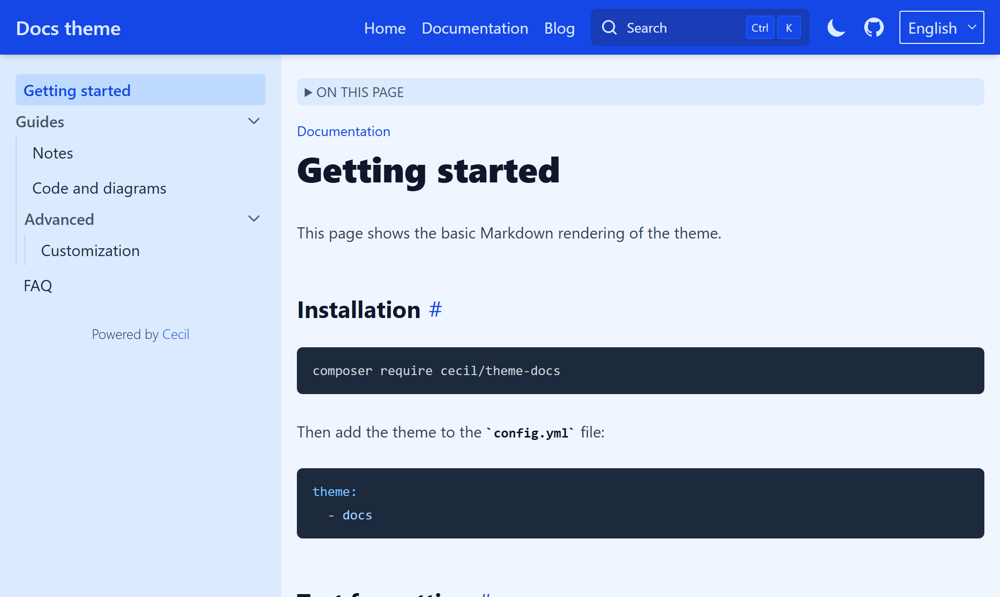

# _Docs_ theme

_Docs_ is a documentation theme for [Cecil](https://cecil.app), designed to provide a modern and responsive interface for your project's documentation, powered by [Tailwind CSS](https://tailwindcss.com) and [Algolia DocSearch](https://docsearch.algolia.com).



## Features

- Auto-generated navigation sidebar (based on nested sections), with collapsible groups
- Search: [Algolia DocSearch](https://docsearch.algolia.com) or [FlexSearch](https://github.com/Cecilapp/theme-flexsearch) integration
- Copy button on code blocks
- "Edit this page" link and "Last updated" date
- Previous/next navigation through nested sections
- Custom 404 page
- Ready for content localization (l10n)
- Templates internationalization (i18n)
- Mobile friendly
- Dark theme
- Blog posts templates

## Installation

```bash
composer require cecil/theme-docs
```

> Or [download the latest archive](https://github.com/Cecilapp/theme-docs/releases/latest/) and uncompress its content in `themes/docs`.

## Usage

Add `docs` in the `theme` section of the `config.yml`:

```yaml
theme:
  - docs
```

### Configuration

The navigation sidebar is generated automatically from the folders structure of
`pages/docs/`, based on [nested sections](https://cecil.app/documentation/content/#sub-section):
each sub-folder containing an `index.md` file becomes a collapsible group, at
any depth. Ordering is based on pages `weight` (e.g. a `1-` filename prefix or a
`weight` front matter variable).

> [!NOTE]
> The `1-` prefix is removed from file names only: use the `weight` front matter
> variable in the `index.md` file of a sub-folder to order it (the prefix would
> otherwise be kept in its URL).

Groups are open by default. Set `collapsed: true` in the front matter of a section
(`index.md`) to collapse it, or `sidebar.collapsed: true` in the configuration to
collapse all of them: the group of the current page is always open.

The `updated` front matter variable of a page is displayed as its "Last updated"
date (enable `lastupdated` to display the page date otherwise).

```yaml
footer: Copyright © %author%
github:
  url: https://github.com/<org>/<repo> # GitHub link in header
  repo: https://github.com/<org>/<repo> # "Edit this page" link
  branch: <main|master>
  path: pages # pages directory path in the repository (default: pages)
sidebar:
  collapsed: false|true # collapse the navigation groups, except the current one (default: false)
lastupdated: false|true # display the page date as "Last updated" date (default: false)
language_cookie: <name> # cookie storing the language chosen with the selector, e.g. `nf_lang` for Netlify (default: false)
inline_styles: true|false # inline the stylesheets in production: no extra request, but not cached by the browser across pages (default: true)
```

### Search
### Versions

To publish several versions of the documentation (e.g. one deployment per
version), list them in the `versions` option: they are displayed in a selector,
next to the site title.

```yaml
versions:
  - name: '2.x'
    url: https://docs.example.com/
  - name: '1.x'
    url: https://v1.docs.example.com/
version: '2.x' # name of the current version (default: the first one)
```


The search button is displayed in the header, with one of the following
component themes (DocSearch takes precedence if both are enabled).

#### Algolia DocSearch

Install the [DocSearch component theme](https://github.com/Cecilapp/theme-docsearch),
add it after `docs` and provide your Algolia credentials:

```bash
composer require cecil/theme-docsearch
```

```yaml
theme:
  - docs
  - docsearch
docsearch:
  appId: <YOUR_APP_ID>
  indexName: <YOUR_INDEX_NAME>
  apiKey: <YOUR_SEARCH_API_KEY>
```

See the [DocSearch component theme](https://github.com/Cecilapp/theme-docsearch#configuration) for other options.

> [!NOTE]
> DocSearch used to be built into the theme: the `docsearch` configuration is
> unchanged, but the `docsearch` component theme must now be installed.

#### FlexSearch

As an alternative to DocSearch (no external service), install the
[FlexSearch component theme](https://github.com/Cecilapp/theme-flexsearch) and add it after `docs`:

```yaml
theme:
  - docs
  - flexsearch
```

### Logo

The site title is displayed in the header, with an optional logo (an image of
the `assets/` folder), single or one per color theme:

```yaml
logo: logo.png
# or
logo:
  light: logo-light.png
  dark: logo-dark.png
```

### Menus

The `main` menu is displayed in the header (and in the sidebar on mobile), the
optional `footer` menu in the footer:

```yaml
menus:
  main:
    - id: docs
      name: Documentation
      url: /docs/
      weight: 10
  footer:
    - id: cecil
      name: Cecil
      url: https://cecil.app
```

### Homepage blocks

The homepage is built from blocks, listed in its front matter (`pages/index.md`),
followed by its content:

```yaml
---
title: Home
blocks:
  - name: hero # site title and baseline
    description: A **Markdown** text.
    image: hero.svg # optional
  - name: cta # call to action
    button: # optional: first page of the documentation by default
      title: Get started
      url: /docs/
    links:
      - title: GitHub
        url: https://github.com/<org>/<repo>
  - name: features
    features:
      - title: Feature 1
        description: A **Markdown** text.
---
```

### Notes

Notes (callouts) are written with [Cecil's notes syntax](https://cecil.app/documentation/content/),
with the `info`, `tip`, `important`, `warning` and `caution` types:

```markdown
:::tip
**Tip:** helpful advice for doing things better.
:::
```

### Blog

Posts of the `blog` section display their date, reading time and author(s):
`author` (or `authors`) front matter variable, as an object (`name`, `title`,
`url`, `email`, `image`) or as a key of `data/authors.yml`.

### Stylesheets

A template extending the theme layouts can load additional stylesheets with the
`styles_extra` variable, set **outside of any block** (a variable set in a block
is not visible in the parent template). They are loaded before the theme stylesheet:

```twig


```

The `styles` block outputs additional `<head>` tags, before the theme stylesheets.

## Development

### Install deps

```bash
composer install
```

### Rebuild CSS

```bash
composer css:build
```

CSS is compiled with [tailwind-builder](https://github.com/ArnaudLigny/tailwind-builder),
which uses the [Tailwind](https://tailwindcss.com) standalone binary (no Node.js required).
The compiled `assets/styles.css` is committed: the CI checks it is up to date with its sources.

### Demo site

The `demo/` folder contains a site using this theme (nested sections, notes,
code, Mermaid diagrams, blog, FlexSearch, French translation), to test changes locally with
[Cecil](https://cecil.app/download/):

```bash
php demo/link.php # links the repository as `demo/themes/docs` and installs FlexSearch (once)
cecil serve demo
```

## License

_Docs_ theme is a free software distributed under the terms of the MIT license.

© [Arnaud Ligny](https://arnaudligny.fr)
