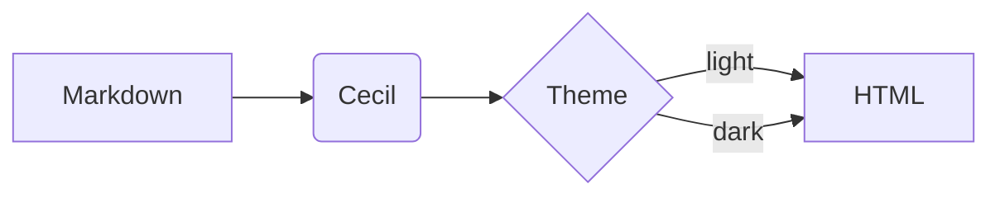
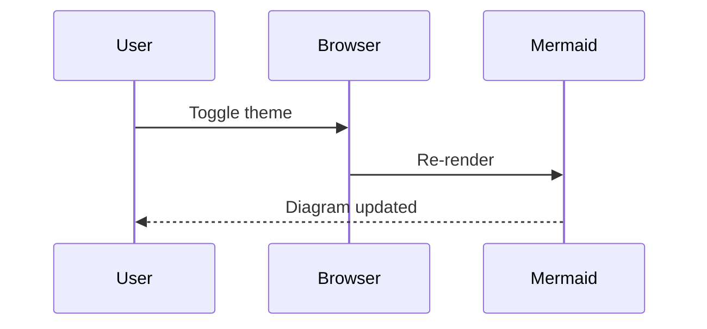

# Code and diagrams

## Syntax highlighting

```php
<?php
$builder = new Cecil\Builder($config);
$builder->build(['drafts' => false]);
```

```twig

  <a href="{{ url(p) }}">{{ p.title }}</a>

```

```javascript
document.querySelectorAll('article h2').forEach((el) => console.log(el.id));
```

## Mermaid

Switch the color theme to check that the diagram is re-rendered.





## Long page

The sections below make the page long enough to test the "On this page" table of contents and the "Back to top" button.

### Section A

Lorem ipsum dolor sit amet, consectetur adipiscing elit. Sed do eiusmod tempor incididunt ut labore et dolore magna aliqua. Ut enim ad minim veniam, quis nostrud exercitation ullamco laboris nisi ut aliquip ex ea commodo consequat.

### Section B

Duis aute irure dolor in reprehenderit in voluptate velit esse cillum dolore eu fugiat nulla pariatur. Excepteur sint occaecat cupidatat non proident, sunt in culpa qui officia deserunt mollit anim id est laborum.

### Section C

Lorem ipsum dolor sit amet, consectetur adipiscing elit. Sed do eiusmod tempor incididunt ut labore et dolore magna aliqua. Ut enim ad minim veniam, quis nostrud exercitation ullamco laboris nisi ut aliquip ex ea commodo consequat.

### Section D

Duis aute irure dolor in reprehenderit in voluptate velit esse cillum dolore eu fugiat nulla pariatur. Excepteur sint occaecat cupidatat non proident, sunt in culpa qui officia deserunt mollit anim id est laborum.
